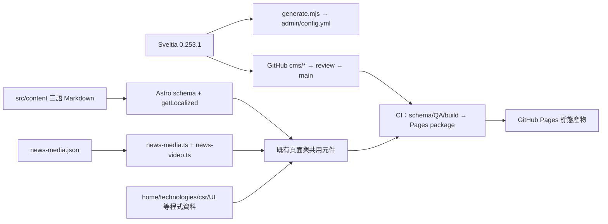

# 現況盤點與實際資料流

以 README 的 main SHA 為準。依據：AGENTS、ARCHITECTURE、CMS-FIELD-MAP，以及下列實際程式；舊文件與實際行為不同時，以程式標記差異，不修改正式資料。

## 系統責任

CI 與 deploy 的設定可從 `.github/workflows/ci.yml` 確認，但無法只從它推定真人登入、GitHub 分支規則、某次 PR 或線上部署已成功。舊 EmDash／Cloudflare integration 仍有 build 耦合，這次不清除、不啟用、不新增服務。

## Collections 與位置

| 資料 | 現有 Markdown TW／EN／JP | CMS | 前台 |
| --- | --- | --- | --- |
| News | 各 30 | news-tw/en/jp | ArticleDetail、NewsListPage；ARTICLE_ID／mediaId 不變 |
| Products | 各 12 | products-tw/en/jp | 既有產品頁、landing、卡片；Hero code／relations 仍依原 schema |
| Solutions | 各 6 | solutions-tw/en/jp | 既有方案頁與卡片；不是僅四個首頁精選就只有四份資料 |
| Pages | 各 14 | pages-tw/en/jp 固定檔案 | 各既有 route；history.md 留存但不開放、不重新公開 |
| Insights／Case Studies／Tags／Investor Items | 目前 0 | 各三語入口 | schema／元件存在；不能把 tests/fixtures 的測試資料當正式文章 |
| Technologies | 無對應 collection | 沒有全文入口 | technologies-content.ts、batch-two 模組、既有七項路由 |
| Typography | JSON | 一個集合 | 換行詞庫及語意分組 |
| News media | 30 個 registry record | 一個 JSON 進階集合 | 封面、照片、影片及來源 |
| CMS test | 隔離目錄 | 一個集合 | 不在 src/content，不產生公開文章 |

共 8×3＋3＝27 個後台 collections；62 個 Markdown 邏輯項目包含保留／草稿頁，不等於已在正式站公開 62 篇。七項技術應作獨立「程式來源、待後台化」完成度，不納入假造的 Markdown collection。

## TW 與公開資格

`src/lib/content.ts` 依同 slug 對應三語，TW 為 base。draft、未來日期、approval 控制公開；缺 TW 或語言檔時不產生該語路由。pending 仍可能產生待譯頁及 noindex，因此「檔案存在」「已翻譯」「可公開」「已部署」須分開顯示。

固定頁例外：部分路由直接 getEntry，不讀 draft。產生器現在只對 privacy 顯示此欄位；不要重新加上看似可下架、實際無作用的開關。history 排除也須保留。

## 媒體真實行為與文件差異

- `ArticleDetail.astro` **目前是 registry media.cover 優先，TW frontmatter cover 次之**。舊 CMS-FIELD-MAP 的「文章明確 cover 優先」與此相反；本報告記錄差異，不在 Phase 0 偷改優先順序。
- 本文 historical article 走 marked.parse；其他文章走 Astro rendered HTML。只加 remark plugin 不能保證同時覆蓋兩條路徑。
- NewsGallery／NewsVideos 由 ArticleDetail 在正文之後渲染；目前 registry 沒有中段位置資訊。HTML 可插入字串不等於本地資產已被 Astro 解析或具有圖集功能。
- news-media.ts 只接受既有 lowercase jpg／jpeg／png 新聞照片，須 approved 且三語 alt 齊全才顯示；本地影片須 /media/news/*.mp4/webm、approved 且存在。其他產品／Logo 的 WebP 是另一個現有載入路徑，不能推論新聞 helper 已支援所有格式。
- 基準無正式新聞照片／本地新聞影片，可核准封面為 0；30 篇新聞缺少可用封面。這是快照，不代表管理者正在同步的素材未上傳或可以刪除。
- 掃描 46 個版本控管媒體（含首頁影片），8,324,210 bytes。尺寸、sha256、明確引用與 registry 使用證據見 ASSETS／ASSET-USAGE；literal scan 不是完整動態使用證明。

## 欄位與字串盤點

`generate.mjs` 依真實 Zod schema 生成巢狀欄位，正式 config 不可單獨手改。2,504 是包含三語／固定頁重複的「欄位位置」，不是 2,504 種獨立欄位；136 種欄位名稱提出完整雙語草案。1,227 個位置仍顯示 raw identifier。

- FIELDS.csv：每個位置、widget、hint、pattern、enum 與現有標籤。
- FIELD-LABEL-PLAN.csv：同位置的雙語名稱、進階識別碼策略；不重命名儲存 key。
- OPTION-LABEL-PLAN.csv：儲存值保持原樣，顯示名稱與值分離。
- APP-MESSAGES.csv：固定版 upstream 英文 1,095 個應用訊息 key，含現有 TW、fallback 與待語意審閱草案；其中 295 個沒有該檔的 TW 對應，不能以此宣稱 UI 全部未翻譯或已翻譯。
- CUSTOM-MESSAGES.csv：BXR 自訂控制項／產生器的中文 literal／template 盤點。

上游依賴工具列、插值組合及權限錯誤還需要 Phase 1 的畫面走查，不能將靜態字串表當成已驗收的全介面翻譯。
