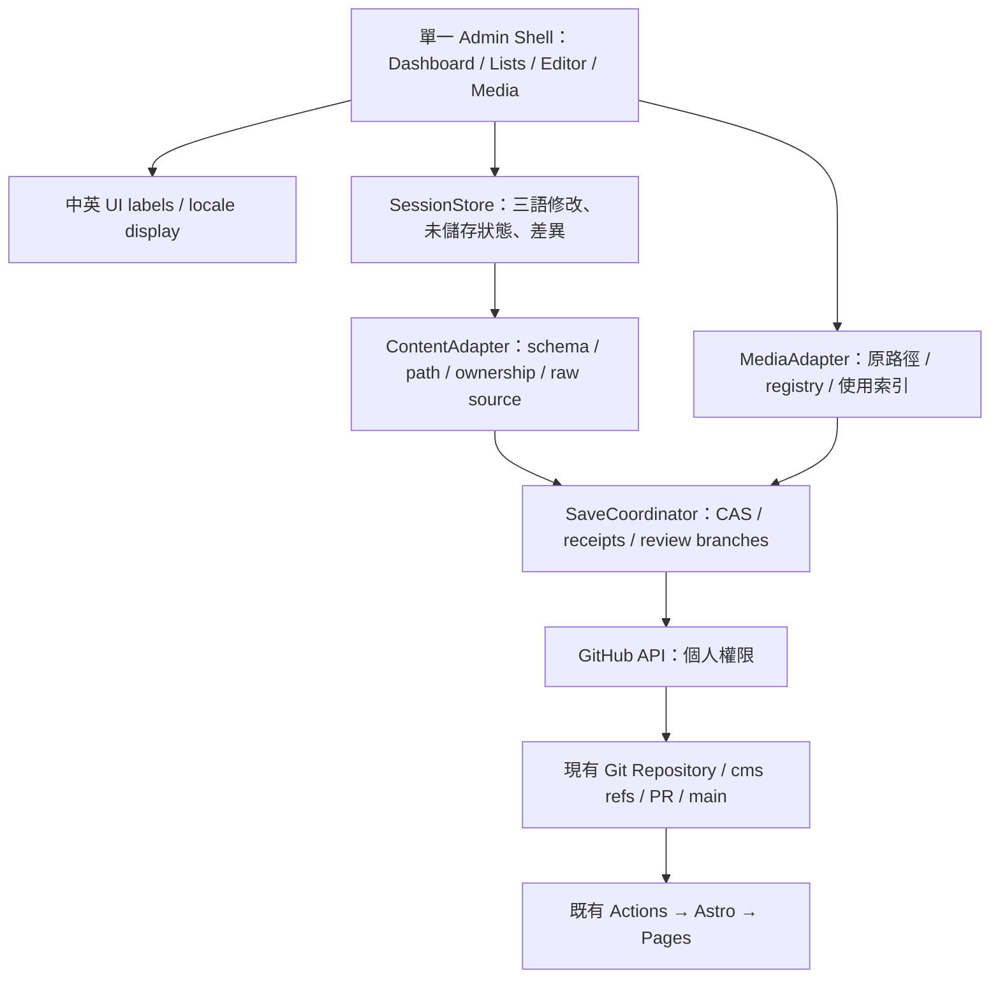

# 技術方案與建議架構

## A／B 比較

| 項目 | A：既有 Sveltia＋公開擴充 | B：客製靜態管理前端，原資料來源 |
| --- | --- | --- |
| 完整目標可行性 | 部分可直接完成；全部雙語 chrome、Dashboard、legacy locale 顯示有缺口 | 可做，但需要自行實作與驗收，不是現成套件即可完成 |
| 單篇三語 | 原生支援，名稱／共用值需處理 | UI 語言與資料夾明確映射，path adapter 不搬檔 |
| 區塊編輯 | 原生 rich text＋自訂 components；不能假設任意 Markdown 保真 | Milkdown＋source adapter＋typed NodeViews；保留 opaque/raw mode |
| GitHub PR | 既有 editorial workflow | Git adapter 建草稿 ref／PR，保留 GitHub 審核與必要 CI |
| 新增伺服器 | 不需要；不為外掛新增服務 | 不需要；瀏覽器使用 GitHub API，Astro／Pages 仍靜態 |
| 開發時間 | 雙語欄位／關聯約 0.5–1 focused day；完整需求需 fork 並另估 | 完整分段約 8.5–13 focused days，含 AI 輔助、測試與審閱；見時程 |
| 維護 | 較低，但 fork／DOM hack 會迅速提高 | 中等：Git API、資安、編輯器與 schema adapter 由 BXR 維護 |
| 權限 | GitHub 角色與分支保護；非完整細粒度 RBAC | 同樣限制；自製 UI 也不能憑空限制 PAT 的 repo 能力 |
| 相容性 | 最接近既有設定，但一般序列化仍可能重排／省略欄位 | 可保留原始檔與局部 patch；需要更完整 corpus 測試 |
| 擴充 | 以已公開 API 為界；缺口不能以 undocumented API 保證 | 模組界線清楚，可做完整管理流程；不要增加第二份內容模型 |
| 切換 | 維持現 CMS | 驗收前僅隔離 POC；切換時由單一 /admin 入口取代，不雙寫 |

## 建議：完整目標採 B，Phase 1 的 A 改善可獨立先上

A 可降低近期使用門檻，但不應在 Phase 1 結束就宣稱達成完整 CMS 2.0。B 的目的是替換操作前端，不是新增資料庫、CMS 內容來源或正式部署流程。管理者尚未批准 B，本次不實作正式後台。

## 模組責任

- Admin Shell：依九個內容類別導航；URL 僅管理介面 hash／內部 route，前台 URL 不動。
- ContentAdapter：依目前 collection schema、TW ownership 與原始檔建立 view model。view model 是記憶體投影，不能變成另一套 JSON 文章資料庫。
- PathAdapter：`tw → tw / zh-Hant-TW`、`en → en / en`、`jp → jp / ja-JP`；顯示標籤明確指定，不讓 Intl 把 tw 當語言。路徑以 canonical collection／slug 計算並做 allowlist，拒絕 path traversal。
- SessionStore：切語保留各自 buffer；未儲存離開提示、編輯 dirty state 與 base SHA。預設不把 Token／正文存 localStorage；瀏覽器關閉後未存資料的處理政策需確認。
- GitProvider：小型文字批次 GraphQL CAS、媒體分段 staging、PR 查詢、失敗恢復；不在元件各自呼叫三次 PUT。
- MarkdownAdapter：保留原 source、CST、opaque spans；能證明安全才開啟視覺控制；未知語法回原始模式。
- MediaAdapter：原始 binary、src、mediaId、registry 不重命名；索引由它們衍生，不雙重維護。

## 部署、權限與安全

仍只有現有 Actions／Pages。新 shell 先在非正式測試路徑、只讀真實內容／只寫隔離 repo 或合成資料；不把 POC 指到正式 GitHub 寫入。切換時保留上一版 admin artifact／Git tag；只有一個後台可正式寫入。

沿用每人限倉庫 PAT 的無伺服器登入；不把 OAuth client secret、共用 Token 或管理者密鑰放前端。Token 僅 session memory，登出清除；續期／重新登入由本人執行。GitHub Write 權限不等於只改內容：main 必須有 PR／必要 CI／review，程式與設定由 CODEOWNERS 審核；UI 隱藏不是安全邊界。

對 Markdown／媒體 URL／API 錯誤做輸入驗證；預覽不能直接執行任意 HTML、script、iframe。Pages 沒有 `_headers` 安全標頭能力，不能把這當防護；可評估 meta CSP、sandbox 預覽與 sanitization，並實測。新 sanitizer／UI 套件待 Phase 3 決策與大小測量，不在 Phase 0 偷加正式依賴。

## 資料結構界線

不新增第二份文章 body。正文仍 Markdown；多媒體 block 的標記格式是 Phase 3 待批准的擴充，不直接更改現有文件。產品／方案的 landing 是結構化 frontmatter，先保留 typed forms，不把全頁重寫成 Markdown。Technologies 仍 TS，只讀／明確標示；全文後台化需要原文等值遷移獨立 PR。
