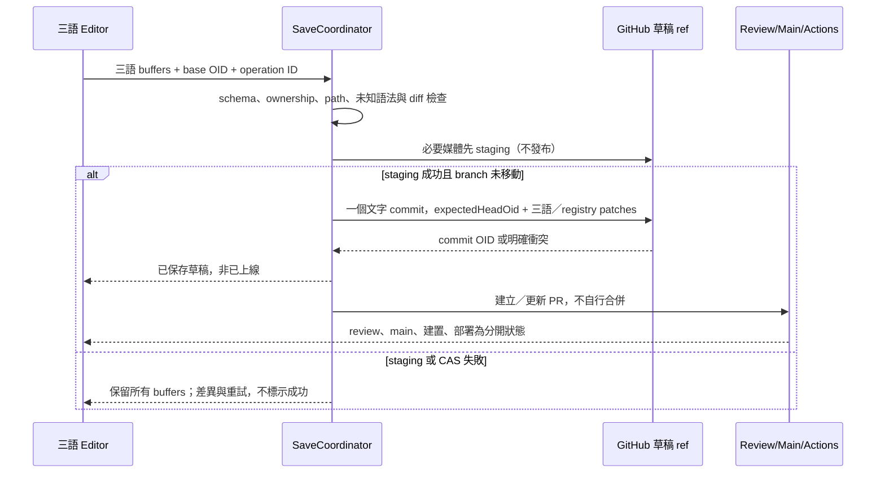

# 三語編輯、多人協作與儲存

## 路徑與來源

邏輯鍵為 collection＋既有 slug；新聞同時核對 ARTICLE_ID。讀取三份 Markdown、同一個 base commit、各 blob SHA、原文 bytes、未知欄位與 parser 診斷，保留 tw/en/jp 既有路徑。路徑不由任意文字輸入拼接；case-studies 前台仍為 cases。

UI 顯示「繁體中文 TW／English EN／日本語 JP」；每語 buffer、dirty flags 與選取區塊獨立，切換只改 active pane，不重新下載或覆蓋其他語。共用設定面板獨立顯示，來源與文字不同層。切換前 flush 尚未提交的 editor transaction；IME 組字期間不切換／不保存半字。

## 欄位 ownership

- 共用結構候選：draft、日期、分類、排序、關聯 slug、ARTICLE_ID／mediaId、核准及 CSR 主題；以實際 renderer 使用 TW 的欄位為準。
- 在地化：title、summary、body、SEO、Hero 文案、alt、caption、按鈕與 FAQ；不能把一整個 hero／landing 物件當共用欄位複製。
- 原檔中的 EN／JP 結構欄位可能 absent、使用 schema default 或保留舊值。SHARED-FIELDS.csv 的 29 組差異包括 privacy draft、related arrays、hero.code；不是自動修正清單。
- 現有記錄：未碰的欄位保留原 bytes；明確修改共用設定時，diff 顯示將修改哪幾份檔，依已核准 ownership 策略 patch，不能任何 Save 都 duplicate 全檔。
- 新記錄：同 slug 建立三語，僅對 schema 必填的共用值依規則初始化；EN／JP pending，TW draft=true。正式 Publish 前三語與核准／日期條件皆檢查。

## 一次提交 ≠ 三次寫入

建議文字與必要 registry patch 合成一次 GitHub `createCommitOnBranch`，傳入 `expectedHeadOid`、全部 additions／deletions。小型三語文字批次設明確大小上限（初步 512 KiB，須實測調整）；超過時拒絕／提示分階段，不能偷偷改成三次 Contents API PUT。

這個 mutation 的單一 commit 才能同時包含三份文字；網路交易、PR 與媒體上傳仍不是全域原子交易。Sveltia 現有 backend 大量資產會拆 commit，不能借用其「Save」字樣保證跨所有內容全成全敗。

## 部分失敗／多人編輯

| 情況 | 必要行為 |
| --- | --- |
| 解析／schema 不符 | 不寫入，保留三語原文與修改；提供人類欄位標籤與進階錯誤細節 |
| 新媒體部分成功、後續失敗 | 停在草稿 branch；舊公開內容不變；顯示已 staging 清單，不假稱全部回滾，不自動刪已存在檔 |
| 另一編輯者／上傳者更新 ref | CAS 失敗即停，重新讀取 HEAD／變更檔，顯示 base／mine／theirs；不能 force push |
| 僅無關檔改動 | 使用者確認後重建同一 patch，以新 HEAD 再 CAS；不得直接以舊整檔覆蓋 |
| 同欄位、同 registry record、正文同段衝突 | 要求明確選擇／合併；三語仍各自保留 buffer |
| server 已 commit，回應中斷 | 結果未知，按 operation ID／paths／hash 查 branch commit；確認一致才標已存，不盲目重送 |
| 三語文字 commit 成功、PR 建立失敗 | 顯示「草稿已存、PR 未建立」，可重試 PR；不重新寫三語資料 |
| main 合併、Actions／Pages 失敗 | 「已合併、部署失敗／待驗證」；保留最後成功站點，不把 CI 關掉 |

operation ID 放 commit message／本地 session，不在 Markdown 新增未核准 schema key；API 重試以 receipt 比對。Token 過期、403、rate limit、timeout 要分開；限速照 Retry-After／reset，重試不跨越權限限制。

## 工作流程

Save Draft → Git 草稿 commit；Submit Review → PR ready；GitHub 審核及必要 CI → main；同 SHA 部署成功 → Published/Deployed。TW draft／日期／核准／翻譯資格另外顯示，不用一個「發布」狀態遮掉它們。

Dashboard 的「已部署」需實際比對成功部署及 build-info，不能只看本地 Git main 或 CMS published flag。沒有權限時顯示「尚未查證」，不是 0 個待審。

## POC 證據與未驗證範圍

GIT-CAS.json：合成 repo 的三語單 commit、prepared object 不動 branch、stale-head 拒絕通過。原始碼保真 patch 亦通過。**沒有呼叫真實 GitHub mutation、測試多人 Token、PR／branch rules 或真實 timeout 恢復**；這些列為 Phase 2 必過 gate，而不是 Phase 0 已完成的線上能力。
